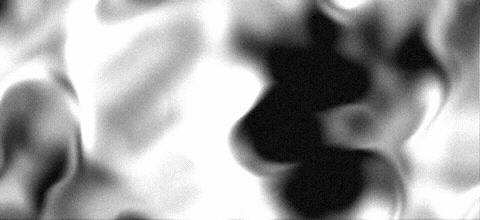
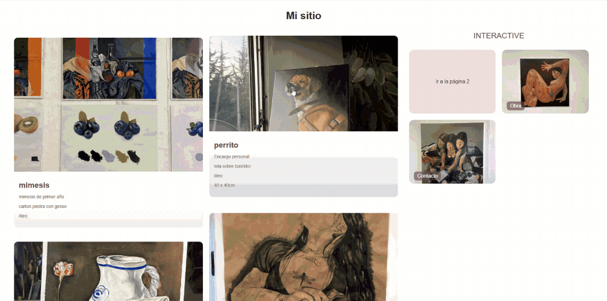
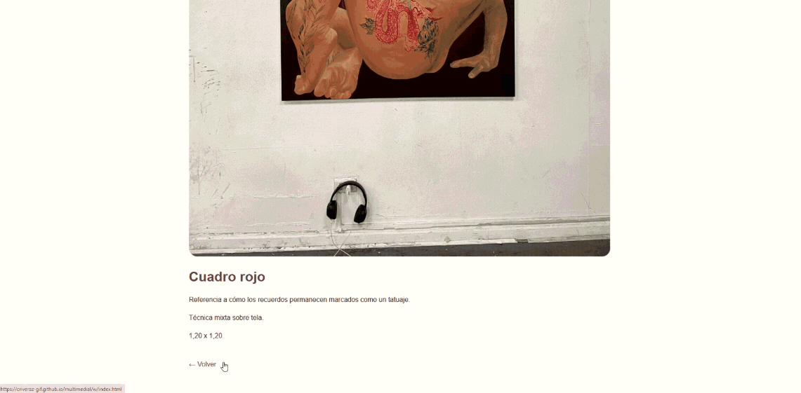
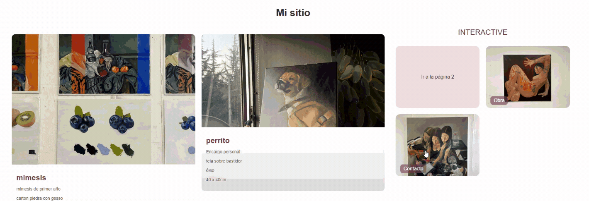
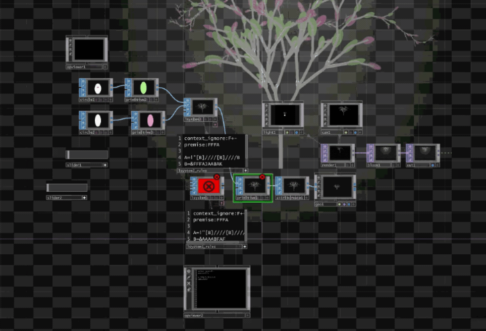
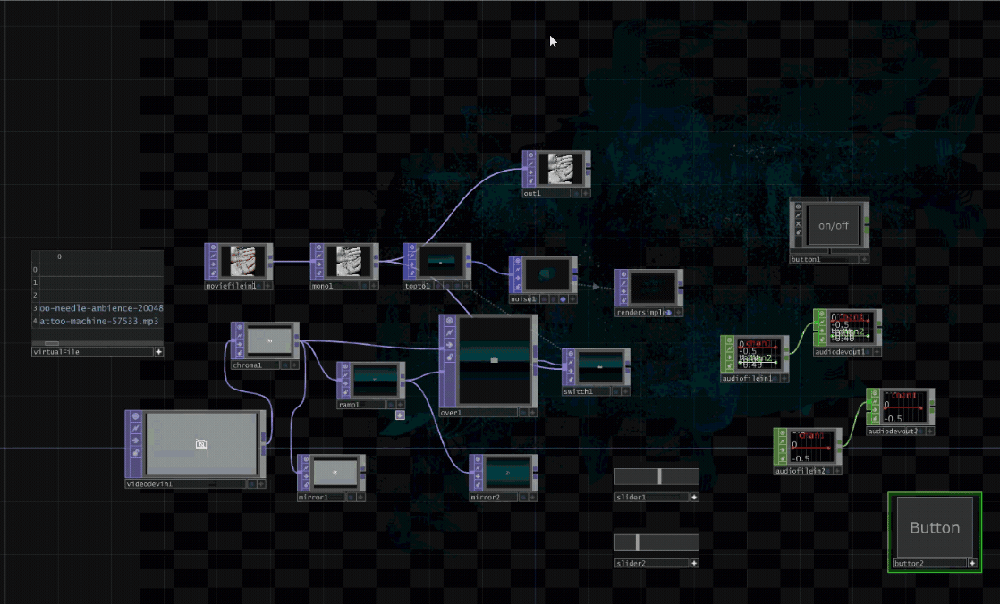
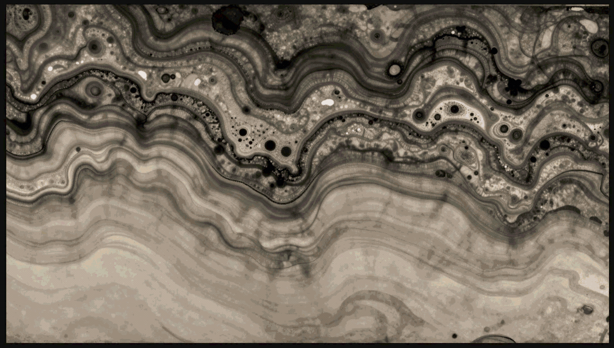
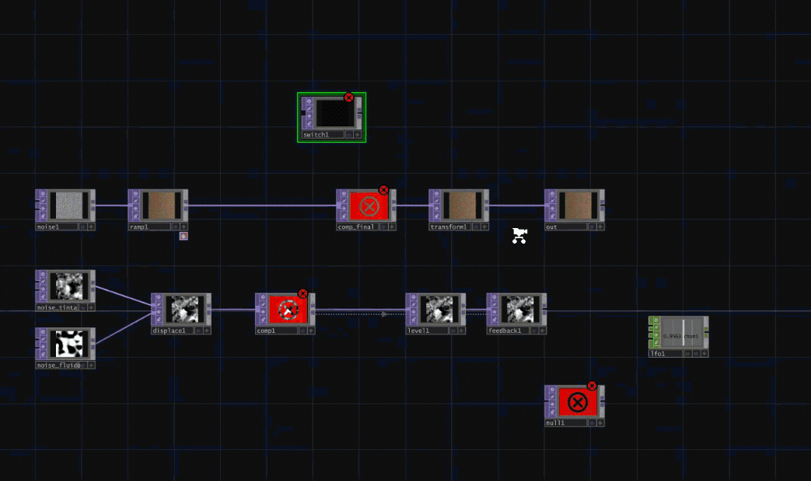

<style>
  body {
    background: linear-gradient(180deg, #ff91cd 0%, #2b1323 100%);
    color: #f5f8f6;
    font-family: Arial, Helvetica, sans-serif;
    line-height: 1.7;
  }
  h1, h2, h3 {
    color: #f4fff9;
    letter-spacing: 0.02em;
  }
  h1 {
    font-size: 2.3em;
    margin-bottom: 0.3em;
  }
  h2 {
    font-size: 1.5em;
    margin-top: 1.5em;
  }
  h3 {
    font-size: 1.2em;
    margin-top: 1.2em;
  }
  a {
    color: #9fe8d8;
    text-decoration: underline;
  }
  a:hover {
    color: #d6fff5;
  }
  hr {
    border: 0;
    border-top: 1px solid rgba(255,255,255,0.15);
    margin: 2em 0;
  }
  ul {
    padding-left: 1.2em;
  }
  .hero {
    background: rgba(255, 255, 255, 0.04);
    border: 1px solid rgba(255, 255, 255, 0.08);
    border-radius: 16px;
    padding: 1.2em 1.4em;
    margin: 1em 0 1.5em;
    box-shadow: 0 10px 30px rgba(0,0,0,0.12);
  }
  .hero p {
    margin: 0.3em 0;
    color: #d4efe8;
  }
  .eyebrow {
    text-transform: uppercase;
    letter-spacing: 0.12em;
    font-size: 0.8em;
    opacity: 0.9;
  }
  div.highlighter-rouge,
  div.highlighter-rouge .highlight,
  div.highlighter-rouge pre {
    background-color: #120b12;
    color: #f2f2f2;
  }
  div.highlighter-rouge pre {
    padding: 1em;
    border-radius: 8px;
    overflow-x: auto;
    border: 1px solid rgba(255,255,255,0.08);
  }
  div.highlighter-rouge code {
    background: transparent;
    color: inherit;
  }
  video {
    display: block;
    width: 100%;
    max-width: 960px;
    margin: 1.5em auto;
    border-radius: 12px;
    border: 1px solid rgba(255,255,255,0.12);
    background: #09070a;
    box-shadow: 0 14px 32px rgba(0,0,0,0.22);
  }
</style>

# Multimedial

<div class="hero">
  <p class="eyebrow">Bitácora de procesos</p>
  <p>Exploración creativa de arte, tecnología y medios digitales interactivos.</p>
</div>



---

### Índice

## Unidad I. [Hipervínculo](https://mauricixx.github.io/multimedial/#unidad-i--hipervicunlo-)
[](https://mauricixx.github.io/multimedial/#unidad-i--hiperv%C3%ADcunlo-)

1. [Mi Primera página.](https://criveraz-gif.github.io/multimedial/w/index.html)
2. [Enlaces - Links](#2-enlaces-y-navegación)
3. [Mini sitio / 3 páginas conectadas](#3-mini-sitio-de-3-páginas)
4. [css-intermedio-interacción-y-layout](#1-css-intermedio-interacción-y-layout)
5. [Mi sitio web experimental/portafolio](#4-mi-portafolio-web)

## Unidad II. [Programación visual creativa basada en nodos](https://mauricixx.github.io/multimedial/#programaci%C3%B3n-visual-creativa-basada-en-nodos)
[](https://mauricixx.github.io/multimedial/#unidad-ii-programaci%C3%B3n-visual-creativa-basada-en-nodos-)

1. [Intro ToucDesigner](https://mauricixx.github.io/multimedial/#1-intro-a-touchdesigner)
2. [Ejercicios:](https://mauricixx.github.io/multimedial/#2-canasta-de-ejercicios)

##### Nube de puntos con Pop basada en imágenes, Lsystem, Mapping básico

---

## Unidad I. Hipervínculo y Desarrollo Web

En esta unidad exploro la base del diseño web: estructura, hipervínculos, organización de contenido y la construcción de páginas funcionales con HTML y CSS.

#### Código base
```html
<!DOCTYPE html>
<!-- Indica al navegador que este documento usa HTML5 -->

<html>
<!-- Inicio del documento HTML -->

<head>
<!-- Sección donde van metadatos, título y estilos -->

<meta charset="UTF-8">
<!-- Define la codificación de caracteres para que se vean bien tildes y símbolos -->

<title>Multimedial</title>
<!-- Título de la página que aparece en la pestaña del navegador -->

<style>
/* Aquí comienza la sección de estilos CSS que define la apariencia visual */

body {
/* "body" se refiere a todo el contenido visible de la página */

  background-color: white;
  /* Define que el fondo de toda la página sea blanco */

  color: black;
  /* Define que el color del texto sea negro */

  margin: 0;
  /* Elimina los márgenes que los navegadores agregan por defecto */

  height: 100vh;
  /* Hace que el alto del cuerpo sea igual al 100% de la altura de la pantalla */

  display: flex;
  /* Activa el sistema Flexbox para organizar y centrar elementos */

  justify-content: center;
  /* Centra el contenido horizontalmente */

  align-items: center;
  /* Centra el contenido verticalmente */

  font-family: Arial, sans-serif;
  /* Define la tipografía del texto */

  font-size: 60px;
  /* Define el tamaño grande del texto */
}
/* Fin de las reglas de estilo del body */

</style>
<!-- Fin de la sección de estilos -->

</head>
<!-- Fin de la sección head -->

<body>
<!-- Inicio del contenido visible de la página -->

MULTIMEDIAL
<!-- Texto que aparece en el centro de la pantalla -->

</body>
<!-- Fin del contenido visible -->

</html>
<!-- Fin del documento HTML -->
```


### 1. Primera página
**Objetivo:** comprender la estructura básica de un documento HTML5 y aplicar estilos iniciales con CSS para centrar elementos y definir una identidad visual clara.

<video controls width="100%" playsinline preload="metadata">
  <source src="https://raw.githubusercontent.com/criveraz-gif/multimedial/main/img/Grabaci%C3%B3n%20de%20pantalla%202026-11-17%20123946.mp4" type="video/mp4">
  Tu navegador no soporta videos HTML5.
</video>
Mi página web, desarrollada desde cero en Visual Studio Code, adopta la filosofía visual y funcional de Pinterest para exhibir una selección curada de mis pinturas y obras artísticas. Al igual que la plataforma original, el diseño prioriza el impacto visual mediante una cuadrícula dinámica de estilo masonry (mosaico asimétrico) que se adapta fluidamente al tamaño y proporción de cada lienzo, eliminando distracciones innecesarias para que el arte sea el protagonista absoluto. Este enfoque no solo permite una navegación intuitiva, fluida y responsiva, sino que transforma el portafolio en un tablero digital interactivo donde cada obra respira y dialoga visualmente con las demás.


### 2. Enlaces y navegación
Se trabajó con la lógica de la hipertextualidad, conectando páginas y creando recorridos entre contenidos para la navegación del usuario.
**Repositorio:** [https://github.com/criveraz-gif/multimedial](https://github.com/criveraz-gif/multimedial)

**Página web:** [https://criveraz-gif.github.io/multimedial/w/](https://criveraz-gif.github.io/multimedial/w/)
### 3. Mini sitio de 
Se desarrolló una estructura de contenido con varias páginas relacionadas, explorando jerarquía visual, consistencia y flujo de lectura.

index.html



 obra.html 

 
 
contacto.html


### 4. Mi portafolio web
Se diseñó una versión personal del portafolio con una composición más pensada, donde la información, la identidad visual y la navegación se articulan como un proyecto coherente.


---

## Unidad II. Programación visual creativa

En esta unidad abordo la experimentación visual y generativa con sistemas de composición, interacción y movimiento, utilizando referencias de layout, nodos y procesos de diseño digital.


**Archivos de trabajo:**
- L-system: [https://drive.google.com/file/d/1KEKyccp2zqGbGFayr2Qr9zndTucRFtTw/view?usp=drive_link](https://drive.google.com/file/d/1KEKyccp2zqGbGFayr2Qr9zndTucRFtTw/view?usp=drive_link)

- Point: [https://drive.google.com/drive/folders/17feG8GRggfg2Q5BfV6B05BZCDDE8ANuk?usp=drive_link](https://drive.google.com/drive/folders/17feG8GRggfg2Q5BfV6B05BZCDDE8ANuk?usp=drive_link)

- Carpeta de point e imágenes: [https://drive.google.com/drive/folders/1qG5LnUaN2CBYvGG9onnshTIrRITrsG3_?usp=drive_link](https://drive.google.com/drive/folders/1qG5LnUaN2CBYvGG9onnshTIrRITrsG3_?usp=drive_link)


PROPMT: Una imagen sobre la construcción de un cuerpo hecho de memoria, sin representar una figura reconocible, que representa capas abstractas de tinta y textura superpuestas unas sobre otras, como estratos que se acumulan y se funden entre sí, en un espacio vacío, sin horizonte ni referencia física.
Visualmente, formas orgánicas irregulares —manchas, líneas ramificadas, texturas porosas similares a piel o piedra— se apilan en distintos niveles de densidad y opacidad, donde las capas inferiores son difusas y casi transparentes y las superiores se vuelven más densas, oscuras y definidas, como si el tiempo mismo se hiciera visible en la acumulación. La composición es vertical y estratificada, sin un centro figurativo claro, dejando que la mirada recorra las capas de abajo hacia arriba como quien lee un corte geológico. La atmósfera es introspectiva y silenciosa, entre lo mineral y lo orgánico, con una tensión sostenida entre lo que apenas existe y lo que ya se fijó para siempre.
Sin figuras humanas ni siluetas reconocibles, sin colores saturados, sin texto legible, sin elementos que sugieran un lugar o tiempo específicos.

Mediante esta instrucción se buscaba que ComfyUI generara una representación visual puramente abstracta sobre cómo se construye una identidad o un "cuerpo" a partir de los recuerdos, evitando deliberadamente cualquier silueta humana o entorno reconocible. El objetivo era traducir el paso del tiempo en una composición vertical de estratos superpuestos —similar a un corte geológico— donde texturas orgánicas y minerales como tinta, piedra y piel evolucionan desde capas inferiores etéreas y casi transparentes hasta sedimentos superiores densos y oscuros. En última instancia, la imagen pretendía capturar una atmósfera silenciosa e introspectiva que reflejara la tensión entre lo efímero que se desvanece y aquello que queda grabado de forma permanente en la memoria.


### 2. Ejercicios en nodos y proyectos
Aquí se incorporan los desarrollos experimentales, la construcción visual con sistemas generativos y la investigación de formas, movimiento y composición digital.

- Carpeta de experimentación: [https://drive.google.com/drive/folders/166Lg73rzj3oeYLozIE8eZclqsVWSi9-1?usp=drive_link](https://drive.google.com/drive/folders/166Lg73rzj3oeYLozIE8eZclqsVWSi9-1?usp=drive_link)


En este trabajo quise experimentar con la materialidad visual de la memoria, trasladando un concepto abstracto e intangible hacia un comportamiento orgánico, fluido y generativo en tiempo real. A través de los nodos en TouchDesigner y sus múltiples conexiones, busqué construir una arquitectura visual que representara literalmente la superposición de capas del tejido y del tiempo: cada nodo funciona como un estrato biológico o temporal independiente, la textura porosa de la piel, el flujo de la tinta que sangra por capilaridad y los bucles de retroalimentación que retienen el rastro. Al entrelazar estas conexiones, la red nodal simula el proceso físico del tatuaje como metáfora del recuerdo, mostrando cómo las experiencias penetran la superficie, se asientan unas sobre otras y terminan fusionándose en una cicatriz viva que respira y late en el espacio.
